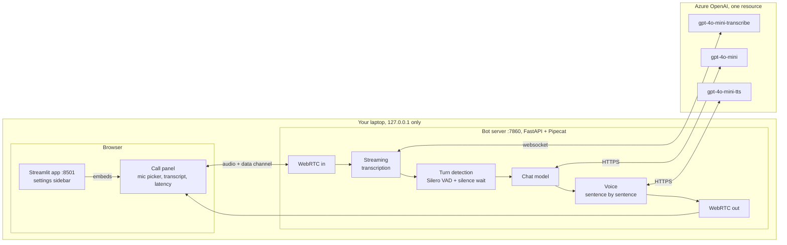
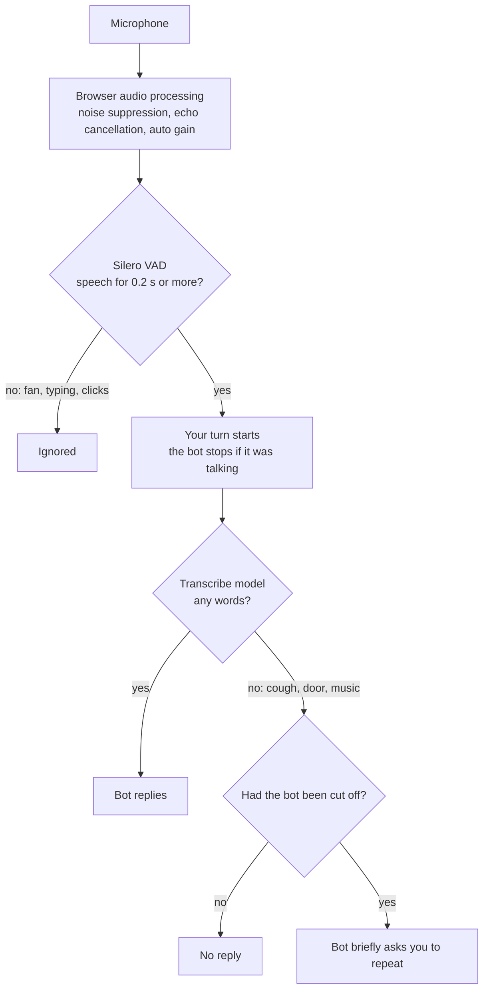

# Voice Bot (Pipecat + Azure OpenAI)

A real-time voice chatbot you run on your own laptop and talk to from the browser, with a Streamlit app for settings and a live transcript.

```
Browser mic ──WebRTC──▶ Silero VAD + streaming transcription ──▶ chat model
                                                              │ streams tokens
Browser speaker ◀──WebRTC── TTS model (sentence by sentence) ◀┘
```

All three models are deployments on **one Azure OpenAI resource**, so the bot needs one key and one endpoint.

- **Streaming:** the reply is spoken one sentence at a time while the LLM is still writing the rest.
- **Barge-in:** start talking while the bot speaks and it stops at once (LLM, TTS and queued audio are cancelled).
- **Turn detection:** Silero VAD, plus a short silence wait (about 0.8 s in total) so brief pauses don't trigger a reply.
- **Memory:** the conversation history is kept for the whole call.
- **Greeting:** the bot says hello when you connect.
- **Latency log:** each turn prints STT final, LLM first token and TTS first byte times to the console, and shows them on the page.
- **Streamlit app:** pick the bot, voice, pause length and system prompt in a sidebar; the call panel shows a live transcript.

Built with Pipecat 1.15.0, FastAPI, the SmallWebRTC transport and Streamlit.

## Architecture



### Frameworks and services

| Layer | What we use | Role |
|---|---|---|
| Voice pipeline | [Pipecat](https://github.com/pipecat-ai/pipecat) 1.15 | Streams audio and text between the steps; handles turn-taking, barge-in and conversation memory |
| Browser ↔ bot audio | WebRTC: Pipecat's SmallWebRTC transport (aiortc) and the browser's own WebRTC | Full-duplex, low-latency audio, peer to peer on the laptop |
| Speech detection | [Silero VAD](https://github.com/snakers4/silero-vad), run locally with ONNX Runtime | Tells speech from silence and noise |
| Hearing | Azure OpenAI `gpt-4o-mini-transcribe`, streamed over the Realtime API websocket | Speech to text while you talk |
| Thinking | Azure OpenAI `gpt-4o-mini`, streaming chat completions | Writes the reply |
| Talking | Azure OpenAI `gpt-4o-mini-tts` | Text to speech |
| Optional | Azure OpenAI realtime model, e.g. `gpt-realtime-mini` | The realtime bot: one speech-to-speech model instead of three |
| Bot server | FastAPI + Uvicorn | Serves the call panel and the WebRTC offer/answer |
| App | Streamlit | Settings sidebar; embeds the call panel |
| Config | python-dotenv | Reads `.env` |

## Keeping replies fast

Where the time goes in one reply, measured from the moment you stop talking. Both rows come from real calls: the first version (one turn), and the current one (median of a 9-turn call). **Hearing** runs until your turn ends, **Thinking** until the chat model's first word, **Talking** until the first audio.

```mermaid
gantt
    title One reply, from the moment you stop talking
    dateFormat x
    axisFormat %-S s
    tickInterval 1second
    section Before
    Hearing  :b1, 0, 1790
    Thinking :b2, 1790, 2630
    Talking  :b3, 2630, 4110
    section Now
    Hearing  :a1, 0, 800
    Thinking :a2, 800, 1620
    Talking  :a3, 1620, 2360
```



| Seconds after you stop talking | First version | Now |
|---|---|---|
| Transcript ready | 1.79 | 0.72 |
| Turn ends | 1.79 | 0.80 |
| Chat model's first word | 2.63 | 1.62 |
| **First audio** | **4.11** | **2.36** |

What we changed, and why it helps:

| Technique | Effect | Where |
|---|---|---|
| **Streaming transcription.** Audio goes to the transcribe model over a websocket while you talk, instead of being uploaded after you stop. | Transcript ready in ~0.7 s instead of ~1.8 s | `AzureRealtimeSTTService` in `bot.py` |
| **Mark the newest transcript final.** The turn ends as soon as it arrives. | Avoids a ~1.5 s safety timer | `AzureRealtimeSTTService.push_frame` |
| **Keep connections open between turns.** | Saves ~0.5–0.8 s per call; a new secure connection costs ~0.7 s on a corporate network | `OpenAILLMService`, `azure_audio_client()` |
| **Speak sentence by sentence.** TTS starts on the first sentence while the chat model writes the rest. | Speech starts before the reply is complete | `TextAggregationMode.SENTENCE` |
| **Tuned silence wait.** 0.2 s VAD stop plus a 0.6 s wait. | Short enough to feel responsive, long enough not to cut in on mid-sentence pauses | `END_OF_TURN_SILENCE_SECS`, sidebar |
| **Barge-in.** The bot stops the moment you talk. | No waiting for the bot to finish | `VADUserTurnStartStrategy` |
| **Local WebRTC, no relay server.** | No extra network hop for audio | `server.py`, `index.html` |

**Why it isn't under 1 second yet:** about 0.8 s is the deliberate silence wait, ~0.8 s is the chat model's first word from an East US 2 resource through a corporate network, and ~0.7 s is the voice. The next steps would be a realtime speech-to-speech model (`bot_realtime.py`, one model, one round trip) or an Azure region closer to you.

## Handling background noise

Several layers keep noise from triggering or derailing the bot:



| Layer | What it does | Where |
|---|---|---|
| Browser audio processing | Noise suppression, echo cancellation and automatic gain, before audio leaves the browser | `micConstraints()` in `index.html` |
| Microphone choice | A headset mic picks up far less room noise than a laptop mic | Mic picker in the call panel |
| Silero VAD | Neural speech detector: needs confidence ≥ 0.7, volume ≥ 0.6, and 0.2 s of speech | Pipecat defaults, `SileroVADAnalyzer()` |
| Words required | A turn only ends once the transcriber returns text, so noise alone never gets an answer | `SpeechTimeoutUserTurnStopStrategy` |
| Empty-turn recovery | If noise cut the bot off and no words came, the bot asks you to repeat (once in a row) | Pipecat's `EmptyUserTurnConfig` default |
| Headphones | Stop the bot hearing, and interrupting, itself | Recommended |

**Known limit:** noise loud and speech-like enough to pass the VAD still cuts the bot off, because barge-in fires on voice activity. Options not enabled yet:
- Azure-side noise reduction for the transcriber (`noise_reduction="near_field"` on `OpenAIRealtimeSTTService.Settings`).
- Interrupt only after a few recognized words (`MinWordsUserTurnStartStrategy`).
- A stricter VAD (`VADParams(confidence=..., min_volume=...)`).

## What you need

- Python 3.10 or newer (tested on 3.14.2, Windows 11)
- Chrome or Edge
- An **Azure OpenAI** resource with three deployments (Azure AI Foundry → Deployments → + Deploy model):

| Purpose | Model to deploy | Setting in `.env` |
|---|---|---|
| Thinking (chat) | e.g. `gpt-4o-mini` or `gpt-4.1-mini` | `AZURE_OPENAI_DEPLOYMENT` |
| Hearing (speech-to-text) | `gpt-4o-mini-transcribe` | `AZURE_OPENAI_STT_DEPLOYMENT` |
| Talking (text-to-speech) | `gpt-4o-mini-tts` | `AZURE_OPENAI_TTS_DEPLOYMENT` |

The `.env` setting is the **deployment name**, which can differ from the model name.

## Setup

In PowerShell:

```powershell
cd pipecat-voice-bot
python -m venv .venv
.venv\Scripts\python.exe -m pip install -r requirements.txt
copy .env.example .env
```

Open `.env` in a text editor, fill in the key, the endpoint and the three deployment names, and save. For the endpoint, either the resource URL (`https://<name>.openai.azure.com/`) or a full request URL copied from the portal works.

> The commands call `.venv\Scripts\python.exe` directly, so you don't need `Activate.ps1`, which company laptops often block.

## Run

```powershell
.venv\Scripts\python.exe -m streamlit run app.py
```

Open <http://127.0.0.1:8501>, choose your settings in the sidebar, click **Connect** and allow the microphone. The bot greets you; then just talk. The Streamlit app starts the bot server for you (on `127.0.0.1:7860`) and embeds its call panel.

| Sidebar setting | Effect |
|---|---|
| Bot | **Pipeline** (transcribe → chat → voice) or **Realtime speech model** (needs a realtime deployment, see below) |
| Voice | The bot's voice |
| Pause before the bot replies | Silence it waits for before answering. Higher: fewer interruptions mid-sentence |
| System prompt | The bot's personality and reply length |

Changing a setting reloads the call panel; click **Connect** again to use it.

Without Streamlit, `.venv\Scripts\python.exe server.py` serves the same call panel at <http://127.0.0.1:7860>, using the defaults from `.env` and `bot.py`.

**Choosing a microphone:** use the dropdown next to the mic indicator. Device names appear once you've allowed mic access; opening the dropdown asks for it. You can switch microphones during a call without reconnecting, and the page remembers your choice.

**Headphones help.** Echo cancellation is on, but with loud speakers the bot can still hear itself and interrupt its own reply.

Stop it with **Ctrl+C**. After changing Python code, restart it; Streamlit's file watcher is off (see Security and data).

**Realtime bot:** `bot_realtime.py` uses one speech-to-speech model instead of three. Deploy a realtime model (e.g. `gpt-realtime-mini`) on the same resource, set `AZURE_OPENAI_REALTIME_DEPLOYMENT` in `.env` to its deployment name, and pick it in the sidebar. It keeps the same Silero turn detection and barge-in.

## Reading the latency log

After each reply you'll see a line like this (a real measurement from testing):

```
[latency] turn 1: STT final +713ms | turn end +810ms | LLM first token +1690ms | TTS first byte +2171ms (from end of user speech)
```

All times are measured from the moment you stopped speaking.

| Stage | Meaning |
|---|---|
| STT final | Your audio streams to the transcribe model while you talk; this is when the final text arrived |
| turn end | The bot decided you had finished (VAD plus the silence wait, and the transcript has arrived) |
| LLM first token | The chat model streamed its first word |
| TTS first byte | The TTS model produced the first audio, roughly when you start hearing the bot |

See [Keeping replies fast](#keeping-replies-fast) for where the time goes and what was done about it.

## Tuning

| What | Where | Effect |
|---|---|---|
The sidebar overrides these per call; these are the defaults.

| What | Where | Effect |
|---|---|---|
| Silence wait | `END_OF_TURN_SILENCE_SECS` in `bot.py` (0.6) | Higher: fewer interruptions on pauses. Lower: faster replies, but the bot may cut in mid-sentence. |
| Voice | `TTS_VOICE` in `.env` | `alloy`, `ash`, `ballad`, `coral`, `echo`, `sage`, `shimmer`, `verse` |
| System prompt | `SYSTEM_PROMPT` in `bot.py` | The bot's personality and reply length. |
| Default bot | `BOT_MODE` in `.env` | `pipeline` or `realtime` |

## Security and data

- The bot server and the Streamlit app listen only on `127.0.0.1`, so no other computer can reach them. If Windows Firewall asks to allow Python, choose **Cancel**; it isn't needed.
- `.streamlit/config.toml` turns off Streamlit's anonymous usage statistics, hides its **Deploy** button (which would publish the app to Streamlit's cloud), and turns off its file watcher.
- No STUN/TURN servers are used. The WebRTC connection between browser and bot never leaves the laptop.
- Your audio, transcripts and replies go only to your company's Azure OpenAI resource, processed in that resource's region.
- The Silero VAD model runs locally.
- The key lives in `.env`. Keep it private; `.gitignore` already excludes it.

## Troubleshooting

| Problem | Fix |
|---|---|
| `KeyError: 'AZURE_...'` | A value is missing from `.env`. |
| 401 errors | Wrong key, or the key belongs to a different resource than the endpoint. |
| 404 / `DeploymentNotFound` | A deployment name in `.env` doesn't match Azure AI Foundry, or the model isn't deployed yet. |
| SSL or connection errors to Azure | The company proxy or VPN may be blocking `*.openai.azure.com`; ask IT. |
| Keys are disabled in the portal | Your company uses Microsoft Entra ID sign-in instead. The code needs a small change: `AzureLLMService` accepts a `token_provider`. |
| Bot interrupts itself | Use headphones, or lower the speaker volume. |
| Status stays at "connecting" | Use Chrome or Edge, and open `http://127.0.0.1:8501` (Streamlit) or `http://127.0.0.1:7860` exactly. |
| Streamlit says "Using the bot server already running" | `python server.py` is still running in another terminal. Stop it, then restart Streamlit. |
| Realtime bot doesn't answer | No realtime deployment, or `AZURE_OPENAI_REALTIME_DEPLOYMENT` doesn't match its name. |

## Files

| File | Purpose |
|---|---|
| `app.py` | Streamlit app: starts the bot server, settings sidebar, embeds the call panel |
| `bot.py` | Pipecat pipeline: transport.input → STT → user context → LLM → TTS → transport.output → assistant context, plus the observer that logs latency and streams the transcript to the page |
| `bot_realtime.py` | Realtime variant: one speech-to-speech model, same turn detection |
| `server.py` | FastAPI: serves the call panel and handles the WebRTC offer/answer at `POST /api/offer`, passing the page's settings to the bot |
| `index.html` | Call panel: Connect/Disconnect, microphone picker and level, live transcript, latency, plays the bot's audio |
| `.streamlit/config.toml` | Keeps Streamlit local, telemetry off, Deploy hidden |
| `requirements.txt` | Pinned dependencies |
| `.env.example` | Template for your Azure settings |

## Pipecat 1.x notes

Pipecat 1.x changed several APIs that older examples still use:

- `PipelineParams(allow_interruptions=True)` was removed. Barge-in is now `VADUserTurnStartStrategy(enable_interruptions=True)`.
- The VAD analyzer moved from `TransportParams` to `LLMUserAggregatorParams(vad_analyzer=...)`.
- `PipelineTask` and `PipelineRunner` are deprecated in favour of `PipelineWorker` and `WorkerRunner`.
- Services take `settings=Service.Settings(...)` instead of `model=` / `voice=` arguments.
- The system prompt goes on the LLM service (`Settings(system_instruction=...)`). An initial `"system"` message in `LLMContext` is deprecated since 1.9.

How this bot talks to Azure:

- **Chat:** `OpenAILLMService` against Azure's OpenAI-compatible `/openai/v1` API. `AzureLLMService` would work too, but it reconnects after 5 s idle.
- **Hearing:** `OpenAIRealtimeSTTService` over Azure's `/openai/v1/realtime` websocket, with a small subclass that marks the newest transcript final so the turn ends as soon as it arrives.
- **Talking:** `OpenAITTSService` with Azure's dated per-deployment API, because `/openai/v1` returned 404 for REST audio calls.
